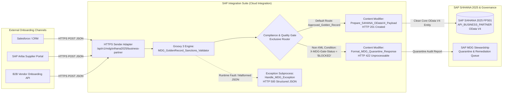

# SAP S/4HANA 2025 MDG Business Partner Golden Record & Sanctions Mesh

[-008FD3?style=for-the-badge&logo=sap&logoColor=white)](https://help.sap.com/docs/cloud-integration)
[](https://api.sap.com/)
[](https://groovy-lang.org/)
[](https://spockframework.org/)
[](LICENSE)

## Executive Overview

In enterprise **SAP S/4HANA 2025 FPS01** greenfield and brownfield transformations, legacy Customer (`XD01`) and Vendor (`XK01`) master records converge into the unified **Business Partner (`API_BUSINESS_PARTNER`)** domain model. Allowing unverified master data from external CRM platforms, SAP Ariba, or self-service supplier portals to enter the S/4HANA core introduces three high-cost operational risks:

1. **Duplicate Golden Records:** Slight variations in legal naming, punctuation, or tax ID formatting create fragmented Business Partner records across `FI-AP`, `FI-AR`, and `MM`.
2. **Failed SEPA & Cross-Border Payment Runs:** Malformed IBAN strings pass basic schema checks only to fail during automated `F110` payment runs.
3. **Regulatory & Sanctions Exposure:** Onboarding counterparties listed on consolidated **OFAC** or **EU Financial Sanctions** watchlists triggers compliance breaches and blocked supply chain execution.

This repository delivers a production-grade **SAP Cloud Integration (CPI)** pre-ingestion governance mesh that acts as an inline **Compliance & Quality Gate** before persisting records into **SAP S/4HANA 2025 OData V4 (`API_BUSINESS_PARTNER`)**.

---

## End-to-End Architecture Flow



---

## Core Architectural Capabilities

### 1. Deterministic SHA-256 Golden Record Fingerprinting
To enforce idempotency and eliminate duplicate Business Partner creation across asynchronous channels, the Groovy 3 engine normalizes legal entity attributes (`BusinessPartnerFullName`, stripped alphanumeric `TaxNumber1`, and ISO 3166-1 alpha-2 `Country`) and computes a canonical 64-character **SHA-256** hash (`X-MDG-Golden-Hash`). Downstream S/4HANA and SAP MDG consolidation hubs use this deterministic fingerprint as an idempotency key.

### 2. Mathematical ISO 13616 Mod-97 IBAN Verification
Rather than relying on superficial regex length checks, the validation pipeline executes full **ISO 13616 Mod-97-10** arithmetic verification in-flight:
- Strips whitespace and normalizes casing.
- Moves the 4-character country/check-digit prefix to the end of the string.
- Converts alphabetic characters to their ISO numeric equivalents (`A=10` through `Z=35`).
- Evaluates `BigInteger.mod(97) == 1` to guarantee bank account mathematical validity before financial master data reaches SAP S/4HANA.

### 3. Real-Time OFAC / EU Sanctions Screening
Before any counterparty reaches the ERP core, normalized entity names are evaluated using normalized string similarity matching against consolidated sanctions watchlists. Any entity breaching the similarity threshold (`>= 0.85`) is immediately flagged with `COMPLIANCE_SANCTIONS_HIT` and diverted away from S/4HANA.

### 4. Clean Core S/4HANA 2025 OData V4 Transformation
Approved records are automatically reshaped into canonical **SAP S/4HANA 2025 `API_BUSINESS_PARTNER`** deep-insert JSON structures (`A_BusinessPartner`, `to_BusinessPartnerTax`, `to_BusinessPartnerBank`), eliminating the need for custom ABAP user-exits or BAdIs inside the ERP core.

### 5. Non-Destructive MDG Quarantine Routing (`HTTP 422`)
Records failing any quality or compliance rule are never silently dropped. The Exclusive Gateway routes them to `Quarantine_MDG_Stewardship`, returning an **`HTTP 422 Unprocessable Entity`** payload containing the deterministic `goldenRecordSha256` hash, ISO timestamp, and itemized violation codes for Master Data Stewards.

---

## BPMN2 Integration Flow Design

| Step | Component Type | Artifact / Step Name | Technical Configuration & Responsibility |
| :--- | :--- | :--- | :--- |
| **1** | **Sender Adapter** | `HTTPS` | Endpoint: `/api/v1/mdg/s4hana2025/business-partner`, Role-Based Auth (`ESBMessaging.send`). |
| **2** | **Groovy Script 1** | `MDG_GoldenRecord_Sanctions_Validator` | Executes field normalization, ISO 13616 Mod-97 IBAN check, sanctions screening, SHA-256 hashing, and OData V4 payload assembly. |
| **3** | **Exclusive Router** | `Compliance_And_Quality_Gate` | Evaluates header `X-MDG-Gate-Status`. Default branch routes clean records; non-XML condition `${header.X-MDG-Gate-Status} = 'BLOCKED'` routes violations. |
| **4a** | **Content Modifier** | `Prepare_S4HANA_ODataV4_Payload` | Sets `Content-Type: application/json` and `CamelHttpResponseCode: 201` on the approved S/4HANA 2025 branch. |
| **4b** | **Content Modifier** | `Format_MDG_Quarantine_Response` | Sets `Content-Type: application/json` and `CamelHttpResponseCode: 422` on the MDG Stewardship Quarantine branch. |
| **5** | **Exception Subprocess** | `Handle_MDG_Exception` | Catches malformed JSON or unhandled runtime exceptions (`CamelExceptionCaught`) and returns structured `HTTP 500` JSON diagnostics. |

---

## Payload Contracts & Runtime Verification

### Scenario A: Valid Business Partner (`HTTP 201 Created`)

**Inbound Request (`POST /http/api/v1/mdg/s4hana2025/business-partner`):**
```json
{
  "BusinessPartnerFullName": "Rheinmetall Industrial Systems GmbH",
  "TaxNumber1": "DE129456789",
  "IBAN": "DE89370400440532013000",
  "Country": "DE"
}
```

**Outbound S/4HANA 2025 OData V4 Payload (`HTTP 201`):**
```json
{
  "@odata.context": "$metadata#A_BusinessPartner/$entity",
  "BusinessPartnerCategory": "2",
  "BusinessPartnerFullName": "Rheinmetall Industrial Systems GmbH",
  "BusinessPartnerGrouping": "BP02",
  "GoldenRecordFingerprint": "8f4b2e9c1a7d6034b5e8912c0f4a7d3e9b1c5a8f2e4d6c8b0a1f3e5d7c9b2a4f",
  "to_BusinessPartnerTax": [
    {
      "BPTaxType": "DE0",
      "BPTaxNumber": "DE129456789"
    }
  ],
  "to_BusinessPartnerBank": [
    {
      "BankCountryKey": "DE",
      "IBAN": "DE89370400440532013000"
    }
  ],
  "ComplianceVerification": {
    "SanctionsCheck": "PASSED",
    "IbanMod97Check": "PASSED",
    "VerifiedAt": "2026-11-16T12:15:00Z"
  }
}
```

---

### Scenario B: Sanctioned Entity & Invalid IBAN (`HTTP 422 Unprocessable Entity`)

**Inbound Request:**
```json
{
  "BusinessPartnerFullName": "Shadow Holdings Ltd",
  "TaxNumber1": "CY99887766",
  "IBAN": "DE00370400440532013000",
  "Country": "CY"
}
```

**Outbound Quarantine Report (`HTTP 422`):**
```json
{
  "status": "QUARANTINED_FOR_MDG_STEWARDSHIP",
  "timestamp": "2026-11-16T12:16:12Z",
  "goldenRecordSha256": "3c9a7e1d5b8f2046a1c3e5f7b9d2a4c6e8f0b1d3a5c7e9f1b3d5a7c9e1f3b5d7",
  "businessPartnerName": "Shadow Holdings Ltd",
  "violations": [
    "INVALID_IBAN_CHECKSUM: Failed ISO 13616 Mod-97 verification for IBAN [DE00370400440532013000].",
    "COMPLIANCE_SANCTIONS_HIT: Entity matched OFAC/EU consolidated sanctions watchlist."
  ]
}
```

---

## Local Test-Driven Development (Spock Framework)

All Groovy 3 message transformation and compliance algorithms are decoupled from runtime dependencies via a lightweight SAP `Message` stub and verified locally using **Gradle** and **Spock Framework 2.3**:

```bash
# Execute all automated Spock TDD specifications
gradle test --info
```

### Verified Test Suite (`MdgGoldenRecordValidatorSpec.groovy`)
- `Should approve valid Business Partner and generate S/4HANA 2025 OData V4 payload with SHA-256 fingerprint`
- `Should quarantine Business Partner failing ISO 13616 Mod-97 IBAN verification`
- `Should block sanctioned entity matching OFAC/EU consolidated watchlist`

---

## Repository Structure

```text
sap-cpi-mdg-business-partner-golden-record-mesh/
├── artifacts/
│   └── IFlow_MDG_BusinessPartner_GoldenRecord_Validator.zip   # Exported SAP CPI BPMN2 iFlow package
├── docs/
│   └── adr/
│       └── 001-golden-record-deduplication-and-sanctions-gate.md
├── src/
│   ├── main/
│   │   └── groovy/
│   │       ├── MDG_GoldenRecord_Sanctions_Validator.groovy    # Core MDG validation & OData V4 mapper
│   │       └── Handle_MDG_Exception.groovy                    # Structured HTTP 500 error handler
│   └── test/
│       └── groovy/
│           ├── com/sap/gateway/ip/core/customdev/util/
│           │   └── Message.groovy                             # SAP CPI Message interface test double
│           └── MdgGoldenRecordValidatorSpec.groovy            # Spock Framework TDD specifications
├── build.gradle                                               # Groovy 3 & Spock 2.3 build descriptor
└── README.md
```

---

**Author:** Željko Popov  
*Integration & SAP S/4HANA Clean Core Architect*
